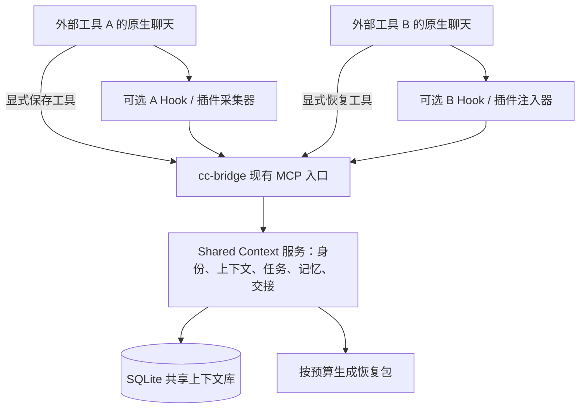

# 外部 MCP 客户端跨工具对话上下文共享方案

状态：建议稿，尚未实现。调研日期：2026-11-18（Asia/Shanghai）。

GitHub 实现补充见 [项目调研与源码核查](cross_tool_context_github_research.md)。后续核查到 deja-vu、claude-mem 和 mcp-memory-service 已有只读历史索引、跨工具 handoff 或 Codex Hook 实现。因此主路线调整为“客户端侧只读转录采集 + Hooks 自动保存/注入”，通用 MCP 显式保存作为兜底；具体客户端版本仍需本项目实测。

## 1. 范围与核心结论

本方案只处理：用户在外部 AI 工具 A 中对话，A 通过 MCP 使用 cc-bridge；切换到同样接入 cc-bridge 的外部工具 B 后，B 能读取并使用先前的目标、对话上下文、记忆和任务进度。

**不涉及 cc-bridge 自带对话功能，不使用其聊天记录作为共享数据源，也不要求用户改用桥托管的 Agent。** 用户始终在原来的 Claude Code、Codex、Cursor、WorkBuddy 等客户端中聊天。

推荐新增 **Shared Context 服务**：cc-bridge 保存独立于外部客户端的共享上下文，客户端通过 MCP 工具写入和恢复；有官方扩展能力的客户端再增加可选采集/注入适配器。

必须区分三个层次：

1. **同一个 MCP 服务可共享数据**：可实现，A 写入桥的内容可由获得授权的 B 读取。
2. **客户端对话自动保存到桥**：MCP 本身不保证；需要 A 主动调用保存工具，或客户端 Hook/插件采集。
3. **B 连接后自动加载上下文**：MCP 本身不保证；需要用户明确调用恢复，或 B 的启动/提示回调自动注入。

因此“任意工具只配一个 MCP 地址，就能自动完整迁移全部对话”不能作为产品承诺。可交付的目标为：**所有可调用 MCP 工具的客户端均可显式共享与恢复；通过适配验证的客户端实现自动采集和恢复。**

同工具原生 resume、cc-bridge 对话页续接、Codex App Server 托管线程恢复均不在本方案内。

## 2. 在线调研依据

| 对象 | 本次查阅的官方结论 | 设计影响 |
|---|---|---|
| MCP Architecture [S1] | 完整聊天历史留在 Host，服务器仅收到必要上下文 | 作为 MCP Server 的桥看不到 A 中从未传给它的聊天；不能从工具调用反推全部对话 |
| MCP 2026-07-28 [S1/S2] | 请求自带协议版本和能力；新传输不再提供旧 `Mcp-Session-Id`、`Last-Event-ID` 机制 | 共享业务上下文必须使用自己的 ID 和同步游标 |
| MCP 2025-11-25 [S3] | 传输会话与事件恢复用于协议通信 | 即使旧连接可恢复，也不代表能恢复外部客户端聊天 |
| MCP Resources [S4] | 可向客户端提供持久资源；是否读取和使用由客户端控制 | 资源暴露/更新通知不等于内容已进入 B 的模型上下文 |
| Claude Code Hooks [S5] | 有 SessionStart、UserPromptSubmit、PostToolUse、Stop、PreCompact 等事件及上下文注入机制；转录可能异步滞后 | 可为外部 Claude Code 做自动适配，联合事件与授权后的只读转录采集；不能只等退出时保存 |
| Claude Code Memory [S6] | 指令、自动记忆与会话上下文是不同机制 | 不把共享上下文简单等同于复制 CLAUDE.md 或自动记忆目录 |
| Codex MCP [S7] | 支持 MCP 工具与服务器 instructions | 可以通过共享 MCP 工具保存/读取；instructions 只能引导行为，不能证明客户端自动导出了聊天 |
| Cursor MCP/Hooks [S8/S9] | 支持 Tools/Prompts/Resources；Hooks 提供会话、提示、响应与工具生命周期入口 | 是可选自动适配对象，仍须按版本验证事件覆盖与注入方式 |
| 官方 memory 示例服务器 [S10] | 可通过 MCP 持久保存实体、关系和观察记录 | 证明共享知识服务可行，但不能替代外部客户端对话采集和恢复 |
| MCP Tasks [S11] | 2025-11-25 中为实验性请求执行状态 | 与用户任务计划不是同一层；自行维护业务任务，不依赖客户端支持 Tasks |

调研结论：优先建设 MCP 共享数据层，不复制原生私有会话库，不拦截供应商全部模型请求，不以 ACP 或 App Server 的原生恢复替代外部 MCP 客户端的上下文共享。

## 3. 需求与兼容性边界

### 3.1 需要共享的数据

| 类别 | 内容 | 数据可信度 |
|---|---|---|
| 对话工作上下文 | 当前目标、用户约束、已确认决策、尝试过的方法、未解决问题、下一步 | 明确区分原文、客户端提交摘要与模型推断 |
| 对话历史片段 | 用户授权采集的用户消息、助手可见回复、工具结果 | 保存来源客户端/原生会话/事件位置及完整性标记 |
| 长期记忆 | 用户要求记住的偏好、项目事实和确认经验 | 自动提取仅为候选，确认后才长期生效 |
| 任务状态 | TODO、依赖、完成项及证据、进行中工作、失败原因 | 自报完成与经过桥验证的结果分开 |
| 工作区引用 | 桥实例、工作区、工作树、提交和相关文件哈希 | 恢复时重新检查，不能只信历史摘要 |

### 3.2 不可自动获得或迁移的数据

- A 没有提交给桥、也没有允许适配器读取的聊天内容。
- 模型隐藏思维、缓存、私有系统提示、供应商内部记忆。
- A 内部正在运行的进程、子代理内存及审批票据。
- 未经用户授权的其他项目、个人记忆和其他会话。
- B 的原生聊天界面历史：可以在 B 中用新聊天继续，不要求把旧消息伪造成 B 的原生历史。

### 3.3 支持等级

| 等级 | 采集 | 恢复 | 产品承诺 |
|---|---|---|---|
| 通用 MCP | 模型显式调用保存工具，或用户触发“保存进度” | 在 B 调用恢复工具 | 共享已提交内容，支持手动续接 |
| 规则增强 | 用户选择安装客户端规则，提示阶段性保存和恢复 | 规则引导模型先调用恢复 | 减少手动操作，但属于模型配合，不能保证每轮成功 |
| 客户端适配 | 官方 Hooks/插件自动采集 | 官方回调把续接包放入模型输入 | 在公布的客户端/版本/事件范围内自动续接 |

首期：Claude Code、Codex、Cursor、WorkBuddy 只要 MCP 工具调用实测通过，就可提供通用模式；参考 GitHub 已有实现，以 Claude Code 和 Codex 作为自动模式首批探针，Cursor 随后扩展。所有自动采集和注入均须本项目按版本验证，不能用受托管 Agent 能力代替验证。

## 4. 架构与当前仓库落点



同一个桥是共享上下文权威节点。A/B 的本地缓存与原生聊天记录仍归各客户端管理。采集器需要部署在外部客户端所在主机；桥装在文件主机不代表它能读取远端客户端的聊天目录。

现有模块复用：

- `desktop/src-tauri/src/mcp/http.rs`：新增共享工具的入口和服务器使用说明，适配现有多版本协议。
- `desktop/src-tauri/src/mcp/tools/registry.rs`：集中注册读写工具，沿用现有门禁。
- `desktop/src-tauri/src/db.rs`：参考现有 SQLite 迁移模式；新增独立 `shared-context.db`。
- `desktop/src-tauri/src/mcp/client_kind.rs`：只用于选择帮助文案；客户端自报名称不能作为身份或能力证明。
- 现有文件白名单、审计、备份：继续保护经过桥的文件操作。

新增 `src/shared_context/{model,store,service,restore,auth}.rs`、MCP 工具处理器和可选客户端适配配置。**不依赖或修改 `cc_session/*`、`cc_history/*` 以及桥内对话界面。** 桥 UI 仅可增加共享上下文列表、最后同步时间、授权和导出管理入口。

### 4.1 首要部署场景：Claude Code 在远端 Linux，桥在 Windows

此场景纳入首版必须通过的验收，不作为特殊兼容案例。明确职责：Linux 是聊天源，Windows 是共享状态中心和文件工具端，目标 B 可以位于 Windows、同一 Linux 或另一台主机。

```text
远端 Linux：用户在 Claude Code 原生聊天
  ├─ Claude Code ── MCP 文件/命令调用 ─────────────┐
  └─ 用户授权的 Hook + 轻量采集器                │
       ├─ 只读本机所选会话转录                    │
       ├─ 增量游标、去重、受限本地待同步队列        │
       └─ 主动上传上下文 ── MCP ingest ───────────┤
                                                 ▼
Windows：cc-bridge
  ├─ 现有文件工具与安全门禁
  └─ 共享历史、检查点、记忆和任务
                                                 ▲
工具 B 所在主机                                   │
  └─ B 原生聊天 ── MCP handoff / restore ─────────┘
```

**部署方式：** 优先在现有远端接入配置流程中增加可选的“启用跨工具上下文同步”，使用现有 SSH 配置能力帮助安装用户级 Hook/采集脚本并显示变更清单。只配置 MCP 的用户仍能手动安装；无需 root、无需安装另一份桌面桥、不包装或替换 Claude 可执行文件。此处是待实现设计，不代表现有远端配置已支持。

**采集方式：** 首版采用事件触发的小脚本，读取当前用户授权的会话转录并上传增量；Hook 先快速写本地队列，上传有界超时，不能因 Windows 离线长期阻塞聊天。启动/提示/轮次完成等事件及后续同步触发补传；需要持续流式同步时再增加可选用户级后台进程，不强制引入 systemd。异步转录缺尾要重新读取对账，不能越过未确认位置推进游标。

**连接方式：** 采集器主动访问与客户端相同的桥 MCP 地址，使用独立受限凭证。可复用现有 VPN/HTTPS 或服务器回环端口的 SSH 反向隧道；隧道场景由 Linux 访问 `127.0.0.1:<远端转发端口>`，经隧道到 Windows 桥。不新增公网监听端口，也不要求 Windows 能直接连接 Linux 上的新服务。B 在另一主机时使用自己的可达入口，不能照抄 Linux 的回环 URL。

**接口与权限：** 新增仅向采集凭证开放的 `context_ingest`，参数至少有 `source_instance_id、binding_id、batch_id、events、source_cursor`，返回已持久化 cursor/seq。它复用 `/mcp` 的版本处理、鉴权、大小限制和速率控制；无需为首版另建 REST 公网入口。采集凭证只允许向授权 context 追加来源事件，不授予 Windows 文件执行、其他项目读取或自动确认长期记忆的权限。会话绑定由用户授权，不能由远端自报 owner 获得。

**身份与工作区：** 用来源主机实例、OS 用户、客户端和原生会话 ID 标识采集源，防多台 Linux/多个用户串线；通过显式 `workspace_id` 关联 Windows 文件工作区。Linux 的 cwd 不等于 Windows 的文件目录，不允许仅按相同目录名自动合并。路径保留来源侧信息，执行文件操作仍按 Windows 白名单重新解析。

**断网与切换：** Windows 不在线时只承诺 Linux 本地待同步，界面区分 captured cursor 与服务器 confirmed cursor。B 只能恢复桥上最后确认的版本；若 A 所在主机不可达，显示尾部缺口，不能假定记录已齐。A 重连后去重补传；B 已产生新状态时，A 的迟到历史不覆盖新主线。

**无 SSH 的降级：** MCP 连接本身不能替用户在 Linux 安装 Hook。没有 SSH 授权时由用户在 Linux 完成可审阅的安装步骤，或者使用通用显式保存；不能把“文件读写 MCP 已接通”显示为“远端聊天已同步”。

验收至少覆盖：Linux A → Windows B、Linux A → 另一 Linux B、同一 Linux A → B；Windows 桥重启、隧道中断与恢复、采集脚本重试、多来源会话同名、远端 cwd/Windows 工作区不一致和旧记录回补。每条路径全程使用外部工具原生聊天。

## 5. 存储、同步与恢复机制

### 5.1 标识与表结构

- `contexts`：共享上下文 ID、owner、workspace、名称、目标、修订号、状态、保留策略。
- `bindings`：context 到外部客户端原生会话 ID 的映射、客户端版本、采集方式、source cursor、覆盖范围。
- `events`：归一化消息/工具结果/决策/任务事件；含来源与完整性，服务端分配递增 seq。
- `checkpoints`：目标、硬约束、决策、任务摘要、下一步、覆盖至哪个 seq、来源引用。
- `memories`：作用域、内容、来源、candidate/confirmed、有效期、版本、替代关系。
- `tasks` / `attempts`：业务任务、每次执行尝试、状态、证据引用、外部运行 ID。
- `handoffs`：交接 ID、来源/目标 binding、冻结检查点、包哈希、状态、过期时间。
- `objects`：附件/大文本引用、哈希、大小、密钥 ID、删除状态。

`context_id` 是共享工作上下文，不是 MCP session，也不是 A/B 原生聊天 ID。用户可在两个原生聊天中显式绑定同一 context；不同项目/不同任务不得默认合并。

### 5.2 通用 MCP 模式

用户在 A 说“把当前对话进度保存到 cc-bridge”，A 调用保存工具，提交目标、关键上下文、约束、任务与下一步。返回 revision 和 last_saved_at，明确这是“已提交摘要”，不是全量聊天备份。

可选客户端规则要求在阶段完成、长任务中途、压缩前和用户要求切换时保存，但规则属于尽力执行；UI 不能仅因规则已安装就显示“实时完整同步”。切换前仍检查最后确认位置。

第一次启用前已发生的聊天，只有客户端仍能访问并提交的部分可导入；完整原文导入需要用户选择文件或授权适配器。桥无法补回客户端已丢弃且未导出的内容。

### 5.3 自动适配模式

采用官方事件采集用户可见消息及工具结果；以本地原生会话 ID 绑定共享上下文，逐批上传稳定事件 ID。完整历史只在用户授权所选会话时只读导入，不扫描所有聊天。

Claude Code 可从 SessionStart/UserPromptSubmit 等入口注入，从 PostToolUse/Stop 等保存；转录异步滞后时以事件提供的末条助手文本补齐并对账。Cursor 按官方 Hooks 事件做同类探针。其他工具无可靠采集/注入能力就保留通用模式，不逆向写入原生私有库。

采集完整性记录为 `submitted_summary / partial_events / visible_transcript`，另有明确 `gaps` 和最后源游标；“所有用户可见事件已覆盖”也不等于内部模型状态可迁移。

### 5.4 同步一致性

- 至少一次投递，`(binding_id, source_event_id)` 唯一约束去重；客户端断网使用加密 outbox。
- 修改带 `expected_revision`，并发冲突返回最新版本，不静默覆盖。
- 事件、检查点引用、任务更新和幂等回执在同一事务提交后才返回已保存；关键数据库采用合适的 FULL 同步策略。
- 通知仅是提示；按 `after_seq` 补拉才是恢复事实依据。MVP 不依赖 Resources、Prompts 或订阅支持。
- 原始事件先持久化，再异步生成摘要；摘要失败仍可读取已提交结构化状态和原文片段。
- 晚到 A 事件保留来源，不自动覆盖 B 接管后产生的任务和确认决策；冲突显式呈现。

### 5.5 B 的恢复包

优先级：用户目标与硬约束 → 已确认决策 → 当前任务与证据 → 下一步/未决问题 → 工作区变化 → 相关确认记忆 → 最近完整轮次 → 原始片段索引。

恢复包包含 JSON 和简洁文本。旧工具调用只作为历史证据，不伪造为 B 的原生 tool message。每条摘要保留来源与覆盖区间，模型猜测不能成为用户明确要求。

按 B 的能力/预算生成包；可先以不超过约 8000 tokens 为调优起点，实际阈值由客户端版本测试确定。超预算时分层读取，硬约束、unknown 操作和遗漏提示不可静默裁剪。目标窗口未知时使用保守字符上限。

只有 B 确实调用了恢复工具、其返回进入当前工具结果，或适配器确认已把包提交到下一轮输入路径，才记录“已提供上下文”。不能把 MCP 连接成功或资源通知发送成功记作恢复完成，也不能把注入回执等同于模型正确理解。

### 5.6 记忆与任务

记忆按 user/project/context 分域；自动抽取进入 candidate，用户明确“记住”或审核后进入 confirmed。原生自动记忆只授权导入，不覆盖 CLAUDE.md、AGENTS.md 或客户端记忆文件。

任务保存 `todo / doing / blocked / done / failed / cancelled / needs_reconcile`。恢复时 doing 保持待核验；桥能观察到的后台运行挂接其 run ID，A 私有进程仅记录状态说明，不能迁移。结果不明的部署、删除、外发等操作禁止自动重跑；done 必须区分模型自报、用户确认与实际证据。

## 6. 外部工具切换流程

### 通用 MCP：必须可用的最小闭环

1. A 中调用 `context_save`，得到 `context_id + revision + 保存时间 + 覆盖类型`。
2. 用户在 B 的原生聊天中说“从 cc-bridge 恢复 context_xxx”；不要求打开桥内对话功能。
3. B 调用 `context_restore`，获得固定 revision 的恢复包。若无 ID，先 `context_list` 由用户选，不能擅自选最近聊天。
4. B 输出“当前目标、完成到哪、下一步、未同步缺口”；必要时核对工作区，随后继续工作。
5. B 后续通过同一 context 保存新进度。切回 A 时再恢复新 revision，不能认为旧 A 聊天已自动知道 B 的修改。

### 自动适配：在验证通过的客户端提供

1. A 的采集器持续上传。用户触发切换时刷出末尾检查点；不支持控制 A 时提示用户结束当前轮次。
2. 建立绑定目标客户端的短期一次性交接凭证。B 的启动/提示 Hook 读取所选 context 并注入恢复包。
3. B 适配器确认包哈希和 revision，交接记录变为 committed；失败保持可重试，不标记成功。
4. A 后续如果继续工作，显示“该上下文已在 B 继续”，新的结构化写入要求重新接管或显式分支。

桥可控制共享状态的写入权；可选将其扩展到受绑定的桥内文件/命令工具。但外部客户端仍可能绕过桥操作本地文件或其他服务，**不能承诺阻止两个外部工具所有并发副作用**。工作区并行修改需监测、提示和重新核对。

异常路径：A 崩溃从最后确认 revision 恢复，并显示尾部未知；B 注入失败可重试同一交接；网络断开显示待同步数量；两端同时更新触发 revision 冲突；相同保存请求/交接提交重试幂等；文件基准变化先核对，不能自动覆盖。

## 7. 关键 MCP 工具与数据结构

以下是 cc-bridge 自定义工具，不是 MCP 协议新增标准方法。通过现有 `tools/call` 调用，读写分开注册以复用只读门禁。

| 工具 | 主要入参 | 作用 |
|---|---|---|
| `context_list` | workspace_id、cursor | 列出有权限的共享上下文 |
| `context_open` | create/bind、context_id、client_instance_id、native_conversation_id | 新建或绑定，返回 binding_id 与修订号 |
| `context_save` | context_id、binding_id、request_id、expected_revision、checkpoint、可选 events | 幂等保存，返回已持久化 revision/seq |
| `context_ingest` | source_instance_id、binding_id、batch_id、events、source_cursor | 受限采集凭证追加来源事件，返回已持久化 cursor/seq |
| `context_restore` | context_id、revision、budget、client_capabilities | 返回恢复包、哈希、覆盖信息和缺口 |
| `context_events` | context_id、after_seq、limit | 按需读取原始片段与增量 |
| `memory_search` / `memory_write` | scope、query 或内容/来源/确认状态 | 分作用域查询与保存记忆 |
| `task_list` / `task_update` | context_id、task_id、expected_revision、status、evidence | 读取/更新业务任务 |
| `context_handoff` | prepare/ack/commit/abort/status、handoff_id、revision | 可选适配器交接状态管理 |

```json
{
  "schema_version": 1,
  "context_id": "ctx_01",
  "workspace_id": "ws_01",
  "revision": 12,
  "binding": {
    "binding_id": "bind_a",
    "client": "external-mcp-client",
    "native_conversation_id": "native_123"
  },
  "checkpoint": {
    "goal": "修复导入失败并补回归测试",
    "constraints": [{"text": "保持旧接口兼容", "source_ref": "ev_20"}],
    "decisions": [{"text": "保留现有解析器", "source_ref": "ev_51"}],
    "completed": [],
    "in_progress": ["核对失败样例"],
    "next_actions": ["定位失败原因，再执行回归测试"],
    "open_questions": [],
    "task_refs": ["task_01"],
    "memory_refs": ["mem_01@2"]
  },
  "coverage": {
    "kind": "submitted_summary",
    "source_cursor": null,
    "gaps": ["未导出完整对话原文"],
    "pending_sync_count": 0
  },
  "workspace_manifest_ref": "obj_manifest_01",
  "saved_at": "2026-11-18T08:00:00Z"
}
```

归一化事件最少包含 `event_id/context_id/binding_id/source_event_id/seq/type/source_ref/payload/schema_version/received_at`。检查点和事件允许来源为客户端提交摘要；没有原文就明确标识，禁止补造 source_ref。

身份通过每客户端凭证与作用域绑定；`context_id`、原生会话 ID 和客户端名称均不是凭证。同一全局 token 的多个请求不能隐式绑定一个“当前上下文”。失败结果使用 `REVISION_CONFLICT / SCOPE_DENIED / CONTEXT_INCOMPLETE / WORKSPACE_DIVERGED / HANDOFF_EXPIRED` 等业务码，不占 MCP 保留错误码。

## 8. 安全与兼容性风险

| 风险 | 措施 |
|---|---|
| 对话从 A 供应商流向 B 供应商 | 首次启用说明目标客户端、数据范围；按已有授权自动执行，敏感项目可禁止跨供应商恢复 |
| 不同项目/用户串线 | 上下文、记忆、任务、全文索引和附件逐请求授权；文件白名单不替代会话访问权限 |
| 全局 token 无法区分客户端 | 增加可撤销、受限的客户端凭证；一次性交接票据绑定主体、目标 binding 和 revision |
| 采集过多或泄露秘密 | 默认所选会话最小化采集，过滤凭据和环境变量原值；可禁止正文采集；明确脱敏有局限 |
| 恶意历史/记忆污染指令 | 历史作为不可信数据；确认规则与用户硬约束单独保存，不因历史文本自动执行命令或提升权限 |
| 本地数据与备份泄露 | 数据库、WAL、FTS、对象和备份一起加密；主密钥由 DPAPI/Keychain 等保护；普通 SQLite 不视为自带加密 |
| 模型不按规则调用保存/恢复 | 保留显式操作，显示最后确认时间；不能用 instructions 的存在证明已完整同步 |
| 客户端能力差异 | 按客户端/版本验证采集、注入、结果大小、工具调用和证书信任；未知版本降级通用模式 |
| 不同路径/工作区 | 以桥实例、workspace、worktree 和相对路径/哈希核验，不能直接执行 A 主机的绝对路径 |
| 遗忘不彻底 | 关联删除原文、摘要、记忆、索引和附件；离线补发先检查删除标记，备份按公开到期策略清除 |

传输继续使用 TLS/SSH、现有鉴权与限流；远程入口验证 Origin。导出包不携带访问 token、审批和执行权限。原始正文建议默认保留 30 天，项目检查点单独配置；归档与删除分开。

## 9. 分阶段实施及验收

按 1 名 Rust/Tauri 开发与 1 名客户端适配/测试协作估算，约 6–8 周；仅通用 MCP 闭环可先交付，自动适配不阻塞其发布。

| 阶段 | 交付 | 验收门槛 |
|---|---|---|
| P0，约 1 周 | 外部 Claude/Codex/Cursor/WorkBuddy 能力矩阵；保存/恢复探针；冻结 schema | 在原生外部聊天完成 A 保存→B 恢复→B 保存→A 恢复；全程不使用桥内对话功能 |
| P1，约 2 周 | MCP 共享存储、手动保存/恢复、任务/记忆、授权与完整性提示 | 工具调用可跨客户端共享；去重/修订冲突/重启恢复/权限隔离通过；未采集内容如实提示 |
| P2，约 2–3 周 | Claude/Codex 只读转录回补、增量采集与外部 Hook 自动模式；Cursor 随后扩展 | 每个宣称支持的版本证明可见事件覆盖与输入注入，并列出缺口；不支持者继续通用模式 |
| P3，约 1–2 周 | 断网补传、工作区校验、导出/遗忘、交接重试和更多版本 | 断线重试无重复，删除不复活，交接失败不误报，旧 MCP 文件能力不回归 |

量化标准（目标值，尚未实测）：

1. 20 条基准对话，每条 10 个关键事实，两方向和切回共 60 次验证；对**已保存**事实恢复正确率 ≥95%，硬约束/未决风险/采集缺口提示召回率 100%。通用摘要模式与自动原文模式分别统计，不能混用分母。
2. ≥90% 基准任务在 B 中无需用户复述已保存背景即可执行正确下一步；真实缺口可澄清，但不能把缺失当作已知。
3. 自动模式对已捕获完整事件的联网落盘确认 P95 ≤2 秒；通用模式只承诺调用成功的数据持久化，不承诺每轮自动保存。
4. 有检查点时，10 万事件数据集的本地恢复包构建 P95 ≤2 秒；不含客户端启动与模型推理时间，固定硬件与包大小测试。
5. 同一事件/保存请求重复 100 次不重复入库；并发结构化修改显式冲突；进程强杀后所有已返回持久确认的事务可恢复。断电保证另做存储故障测试。
6. 无 Resources/订阅/Hooks 的工具可走通用路径；仅连接 MCP 而未保存的聊天明确显示“未采集”，不得显示完整恢复。
7. 跨项目读取、已撤销凭证、重放交接票据和越界附件访问全部拒绝；植入测试密钥不进入恢复包/日志。
8. 两个外部工具同时工作时验证共享状态冲突处理；不把共享状态单写测试包装为外部系统全部副作用互斥。

自动化测试覆盖存储、去重、修订冲突、授权、删除和状态机；真实外部客户端 E2E 验证模型能访问恢复工具返回，以及 Hook 注入确实进入下一轮输入。不得用桥内聊天或受托管线程测试替代。

## 10. 推荐首版范围与待验证问题

首版先打通统一 MCP 恢复接口，并以“外部 Claude Code/Codex 的只读历史回补、增量采集与 Hook 注入”作为首批自动化验证；Cursor 随后扩展。通用 MCP 显式保存/恢复和规则增强作为无自动采集能力客户端的兜底。已有第三方 Codex Hook 源码可作实现参考，但不是本项目的版本兼容验收证据。

必须验证：每家工具的原生会话 ID 获取、用户提示与最终回复事件覆盖、压缩前采集、Hook 超时/失败行为、输入注入机制、返回大小限制、远端采集器权限和身份隔离。Codex/WorkBuddy 没有验证通过的外部会话接口前，不承诺完整自动模式。

用户文案：“在其他 AI 工具里继续当前工作”；同时显示“共享到哪个项目、最后保存时间、保存的是摘要还是原文、还有哪些缺口”。切换不要求使用 cc-bridge 对话页，也不要求更换用户原本的工具运行方式。

## 11. 在线来源

均于本次调研访问，日期为 2026-11-18。具体版本能力须 P0 真机验证。

- [S1：MCP 2026-07-28 Architecture](https://modelcontextprotocol.io/specification/2026-07-28/architecture/index.md)
- [S2：MCP 2026-07-28 Streamable HTTP](https://modelcontextprotocol.io/specification/2026-07-28/basic/transports/streamable-http.md)
- [S3：MCP 2025-11-25 Transports](https://modelcontextprotocol.io/specification/2025-11-25/basic/transports)
- [S4：MCP 2026-07-28 Resources](https://modelcontextprotocol.io/specification/2026-07-28/server/resources.md)
- [S5：Claude Code Hooks](https://code.claude.com/docs/en/hooks)
- [S6：Claude Code Memory](https://code.claude.com/docs/en/memory)
- [S7：Codex MCP](https://developers.openai.com/codex/mcp)
- [S8：Cursor MCP](https://cursor.com/docs/mcp.md)
- [S9：Cursor Hooks](https://cursor.com/docs/hooks.md)
- [S10：MCP 官方 memory 示例服务器](https://github.com/modelcontextprotocol/servers/tree/main/src/memory)
- [S11：MCP 2025-11-25 Tasks](https://modelcontextprotocol.io/specification/2025-11-25/basic/utilities/tasks)
- [S12：MCP Authorization](https://modelcontextprotocol.io/specification/2026-07-28/basic/authorization)

本次交付为范围修正后的规划，未实现功能、未运行真实外部客户端切换试验。性能、成功率和工期为目标或估算。
